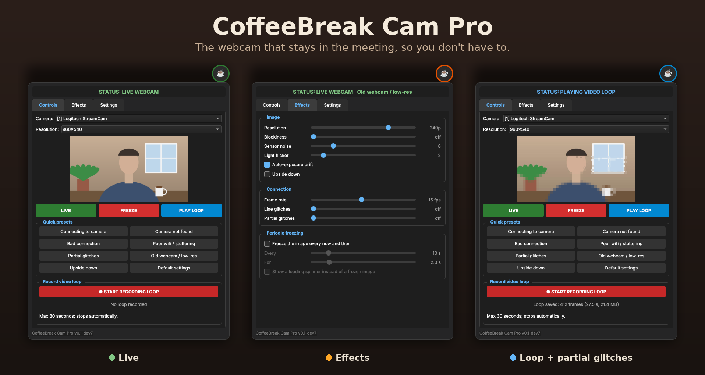

# CoffeeBreak Cam Pro

*The webcam that stays in the meeting, so you don't have to.*



CoffeeBreak Cam Pro sits between your real webcam and your video calls. It shows up as a
virtual camera, and from then on **you** decide what the meeting sees: you, a frozen you, a
looping you nodding thoughtfully, or a heartbreakingly bad connection that nobody can blame you for.

## Why "Pro"?

Because every app is Pro these days. Your notes app is Pro. Your calculator is Pro Max.
We briefly considered the full name:

> **CoffeeBreak Cam Pro Max Ultra — Venti Iced Half-Caf Oat-Milk Caramel Cloud Edition,
> with an extra shot of plausible deniability**

…but it didn't fit on the button. So: Pro. Please pronounce it with the confidence of a
barista calling out a twelve-word drink order.

## What's on the menu

| Drink | What the meeting sees |
|---|---|
| **LIVE** | You. Fresh. Unfiltered (unless you add filters). |
| **FREEZE** | You, perfectly still. Deep in thought. Probably. |
| **PLAY LOOP** | Up to 30 seconds of recorded you, played back and forth so nobody spots the seam. |
| **Bad connection** | Blocks, low frame rate and the occasional freeze. Not your fault. Clearly the wifi. |
| **Poor wifi** | A "Buffering…" spinner at the most convenient moments. |
| **Partial glitches** | Half the picture hangs, a corner goes blocky. Lost packets. Happens to the best of us. |
| **Old webcam** | Grainy, low-res, slightly washed out. Vintage. Artisanal. |
| **Upside down** | The driver got confused. You're a professional; you'll carry on regardless. |
| **Connecting / Camera not found** | The classics. Timeless. |

Switching between live and loop briefly freezes the image, exactly like a real hiccup would.
Every effect can be fine-tuned on the **Effects** tab; the language (English / Nederlands) is
under **Settings**.

## Before you start

Install [OBS Studio](https://obsproject.com/) once. CoffeeBreak Cam Pro borrows its
**OBS Virtual Camera** driver; OBS itself doesn't need to be running. Windows only.

## Option 1: just download it (easiest)

1. Go to the [latest release](https://github.com/gen-x-coder/CoffeeBreakCamPro/releases/latest).
2. Download `CoffeeBreakCamPro-<version>-windows.zip`, unpack it anywhere and start
   **CoffeeBreakCamPro.exe**.

No Python needed. That's it. Go get a coffee.

## Option 2: run it from source

You need [Python 3.10+](https://www.python.org/downloads/) and [Git](https://git-scm.com/).

```
git clone https://github.com/gen-x-coder/CoffeeBreakCamPro
cd CoffeeBreakCamPro
pip install -r requirements.txt
python app.py
```

To update later: `git pull` in the same folder.

## Option 3: build the .exe yourself

From the source folder (option 2):

```
pip install pyinstaller
pyinstaller --noconsole --clean --name CoffeeBreakCamPro app.py
```

The app ends up in `dist\CoffeeBreakCamPro\`. Two large files in there are not used by the app and
can be removed (PowerShell):

```
Get-ChildItem dist\CoffeeBreakCamPro -Recurse -Include opencv_videoio_ffmpeg*.dll, opengl32sw.dll | Remove-Item
```

Zip the whole folder to share it. Official releases are built the same way by GitHub Actions
(`.github/workflows/release.yml`) and attached to each release automatically.
(`--onefile` also works and gives a single .exe, but it unpacks itself on every start, which makes
starting noticeably slower.)

## Using it

1. Start CoffeeBreak Cam Pro. A small ☕ button appears on your screen.
2. In Teams, Zoom or Meet, pick **OBS Virtual Camera** as your camera.
3. Click the ☕ to open the panel, drag it to move it, right-click it to quit.

The ☕ border tells you what the meeting sees: **green** your plain camera, **orange** live with
effects, **red** frozen, **blue** the loop.

## Barista notes

- Settings, window position and your camera's resolutions are remembered in `config.json`
  (next to `app.py` or the .exe). If you change the resolution, the camera switches right away;
  the virtual camera follows on the next start.
- A 30-second loop takes roughly 20–30 MB of memory. Less than one browser tab. Probably less
  than this README.
- If something goes wrong, the app closes both cameras and writes the details to `crash.log`.

## License

CoffeeBreak Cam Pro is released under the [MIT License](LICENSE): use it, change it, share it.
A mention is appreciated; the license only asks you to keep the copyright notice.

The Windows release also contains third-party libraries, each under its own license:
PySide6 / Qt (LGPL-3.0), OpenCV (Apache-2.0), NumPy (BSD), pyvirtualcam (GPL-2.0),
pygrabber and comtypes (MIT). Their full license texts are included in the release zip as
`THIRD_PARTY_LICENSES.txt`. The OBS Virtual Camera driver is part of OBS Studio (GPL-2.0) and is
installed separately.

## Disclaimer

Use responsibly. Your manager may also have read this README.
